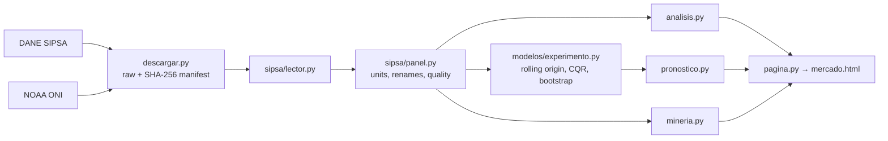

# Mercado al Día

[Español](README.md) · **English** · [Portfolio page](https://johangb.github.io/en/projects/mercado-al-dia.html)

  

**What is cheap this month at the market, how much will it cost next month, and what is worth
waiting for?** Mercado al Día answers using wholesale prices from **SIPSA** (DANE's agricultural
price and supply information system) for Bogotá and the Savannah, with Corabastos as reference.

> **Status: v1.0, phases 0–3 complete.** Verified data, a useful dashboard without ML, models
> validated with rolling origin and a single held-out test, and a published page
> ([demo](docs/demo/mercado.html)). Not financial advice.


## What it does

| Question | How | How it was verified |
|---|---|---|
| What is cheap this month? | Last price vs. median of the previous 12 months (±10 %) | Each price cites file, sheet and row of the DANE spreadsheet |
| In which months is it usually expensive? | Seasonal profile (2×12 moving average on log prices) | "Usually goes up/down" advice is right 78.2 % of the time vs. 73.7 % baseline, without peeking |
| How much in 1, 2, 3 months? | LightGBM at 1 month; calibrated naive at 2–3 months; 80 % interval | Single test 2023-11 → 2026-09: typical error 9.2 % at 1 month; interval covered 82.6–83.3 % |
| How do I fit my basket to my budget? | Replaces products with cheaper substitutes, biggest saving first | Same price unit |
| What should a shopkeeper watch? | Likely rises and drops next month | Rules on the calibrated interval |
| Which products move together? | Correlation of de-seasonalized monthly changes | Only pairs with ρ ≥ 0.5 |

**Main limitation:** SIPSA measures **wholesale** prices at the central market. Retail prices are
higher; the tool anticipates rises, drops and seasons, not the exact shop price.

## Model results

Protocol fixed before seeing the test (`config/modelos.yaml`): rolling origin without leakage,
selection on validation (2021-11 → 2023-10), conformal calibration to 80 % coverage, a deployment
rule requiring significant improvement over the best baseline (90 % bootstrap CI), and a **single test**.

| Horizon | Deployed | Typical error | Coverage | Quantile loss vs. naive |
|---|---|---|---|---|
| 1 month | LightGBM | 9.2 % | 83.3 % | −4.8 % (90 % CI: −8.7 % to −1.0 %) |
| 2 months | Calibrated naive | 16.0 % | 83.0 % | — |
| 3 months | Calibrated naive | 20.2 % | 82.6 % | — |

- **SARIMAX with ONI (El Niño index):** no significant gain over naive.
- **N-BEATS (deep learning, JAX):** lost to naive on every horizon — not deployed.
- **LightGBM at 2–3 months** also won on test, but selection is not changed after looking at the test.

Full report (Spanish): [`docs/modelos.md`](docs/modelos.md) · model cards in [`models/model_cards/`](models/model_cards/).

## Run it

Python 3.10+, runs on Windows 11 with 8 GB RAM and no GPU.

```bash
pip install -e .[dev]
python -m mercado_al_dia.ingesta.descargar   # downloads public data and fingerprints it (SHA-256)
python -m mercado_al_dia                     # dashboard, mining and forecasts (~40 s)
python -m pytest -q                          # 51 tests, offline
```

## Pipeline



## Data sources

DANE SIPSA monthly wholesale price and supply series; NOAA CPC ONI index. Raw data is not
redistributed — it is downloaded by the script. DANE does not participate in or endorse this project.

---
Personal portfolio project by **Johan Esteban García Bautista** · MIT License (code)
