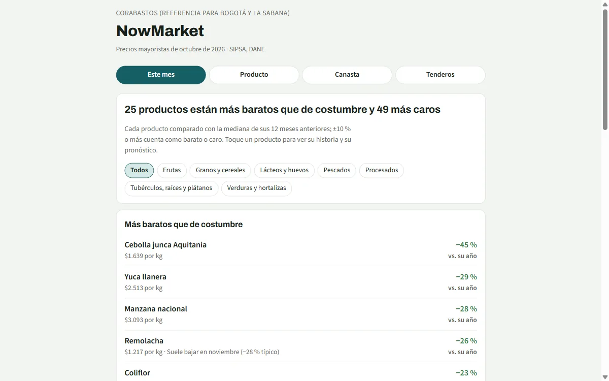

# NowMarket — monthly SIPSA wholesale prices for Bogotá and the Savannah; not real-time or retail prices

[Español](README.md) · **English** · [Portfolio page](https://johangb.github.io/en/projects/mercado-al-dia.html)

  

**What is cheap this month at the market, how much will it cost next month, and what is worth
waiting for?** NowMarket answers using wholesale prices from **SIPSA** (DANE's agricultural
price and supply information system) for Bogotá and the Savannah, with Corabastos as reference.

> **Status: v1.1 (17 Nov 2026).** Verified data, a useful dashboard without machine learning, models
> validated with a rolling origin, and a published page ([demo](docs/demo/mercado.html)). An independent
> audit found method errors in model selection; they were fixed and the test was rerun once (D-030).
> With the corrected rule no model clears the bar: the calibrated naive forecast is used at 1, 2 and 3
> months. Not financial advice.
>
> The GitHub repository is **NowMarket**; the Python package is **`mercado_al_dia`** (commands, imports and
> paths in this document keep that name). The project used to be called "Mercado al Día".



## What it does

| Question | How | How it was verified |
|---|---|---|
| What is cheap this month? | Last price vs. median of the previous 12 months (±10 %) | Each price cites file, sheet and row of the DANE spreadsheet |
| In which months is it usually expensive? | Seasonal profile (2×12 moving average on log prices) | The "usually goes up/down" advice is right 78.2 % of the time without peeking, vs. 73.7 % for the baseline |
| How much in 1, 2, 3 months? | Calibrated naive (the price stays, with an 80 % range): no model beat it significantly on validation | Test 2023-11 → 2026-09: typical error 9.7 % at 1 month; the range covered 80.6–82.8 % |
| How do I fit my basket to my budget? | Replaces products with cheaper substitutes, biggest saving first | Substitutes defined by the author; same price unit |
| What should a shopkeeper watch? | Likely rises and drops next month | Rules on the calibrated range; with the naive forecast an alert fires only if the whole range lies on one side of the current price (today, none) |
| Which products move together? | Correlation of de-seasonalized monthly changes | Only pairs with ρ ≥ 0.5 are shown |

**Main limitation:** SIPSA measures the **wholesale** price at the central market, VAT included, in pesos of
each month. Retail prices are higher (transport, waste, margin). The tool anticipates rises, drops and
seasons; it does not tell you what you will pay at a shop.

**What "1 month ahead" means.** A month's price is published between the 6th and the 17th of the following
month. The "1-month forecast" is issued once that next month has already started, so its real horizon is
about **2 to 3 weeks**, not a full month. Prices are monthly averages, not real-time prices.

## Model results

Protocol fixed before seeing the test (`config/modelos.yaml`):
- **Rolling origin without leakage.** Each month is forecast using only what was published up to that month,
  including the list of products the global models train on (fixed in v1.1).
- **Selection on validation.** Window 2021-11 → 2023-10.
- **Conformal calibration (CQR).** Ranges are adjusted to cover 80 %.
- **Deployment rule.** The model with the lowest validation loss is used only if it beats the best baseline
  with a 90 % CI > 0, using a circular block bootstrap of 3 consecutive months. Otherwise the baseline is used.
- **Test.** Window 2023-11 → 2026-09. **It has been used twice**: on 11 Nov 2026 and, because of the method
  correction (D-030), on 17 Nov 2026. It can no longer be used to decide anything: any new modelling decision
  needs data after 2026-09 (for example, validation 2023-11 → 2025-10 and test from 2025-11, once available).

| Months ahead | Deployed (v1.1) | Typical error | Range covered | Before (v1.0, with method errors) |
|---|---|---|---|---|
| 1 | Calibrated naive | 9.7 % | 80.6 % | LightGBM: 9.2 %, covered 83.3 % |
| 2 | Calibrated naive | 16.0 % | 82.8 % | Calibrated naive: 16.0 %, 83.0 % |
| 3 | Calibrated naive | 20.2 % | 82.3 % | Calibrated naive: 20.2 %, 82.6 % |

- **LightGBM:** it had the lowest validation loss on all three horizons, but its 1-month improvement (+4.2 %)
  has a 90 % CI of [−0.7 %; +8.6 %] with 3-month blocks, so it does not clear the bar. On the test it did beat
  naive; the rule is decided on validation and is not rescued by looking at the test.
- **SARIMAX with ONI (El Niño index):** no significant gain over naive.
- **N-BEATS (deep learning, JAX):** lost to naive on every horizon and is not deployed.
- What changed and why: [`docs/auditoria_independiente.md`](docs/auditoria_independiente.md) and D-030 in
  [`docs/decisiones.md`](docs/decisiones.md). Before and after side by side in [`docs/modelos.md`](docs/modelos.md).

Full report (Spanish): [`docs/modelos.md`](docs/modelos.md) · model cards in [`models/model_cards/`](models/model_cards/).

## Run it

Python 3.10+, runs on Windows 11 with 8 GB RAM and no GPU.

```bash
pip install -e .[dev]
python -m mercado_al_dia.ingesta.descargar   # downloads public data and fingerprints it (SHA-256)
python -m mercado_al_dia                     # dashboard, mining and forecasts (~40 s)
python -m pytest -q                          # 72 tests, offline (see note below)
```

**Tests.** There are 72. With JAX installed (`pip install -e .[dev,dl]`): 71 pass and 1 is a documented expected
failure (`xfail`). Without JAX the 3 N-BEATS tests are skipped (`could not import 'jax'`). In CI, Linux installs
JAX (71 pass) and Windows does not (68 pass, 3 skipped).

`data/raw/` and `data/procesado/` are **not in the repository** (DANE licence and size; D-006 and D-017). Running
the two commands above creates them; without them there is neither the dashboard nor the panel the models use.

## Pipeline


## Data sources

DANE SIPSA monthly wholesale price and supply series; NOAA CPC ONI index. Raw data is not
redistributed — it is downloaded by the script. DANE does not participate in or endorse this project.

---
Personal portfolio project by **Johan García** · MIT License (code)
