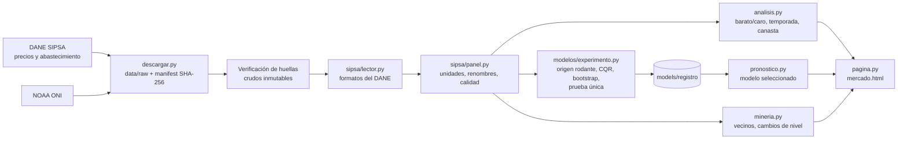

# Mercado al Día

**Español** · [English](README.en.md)

  

**¿Qué está barato este mes en la plaza, cuánto costará el próximo y qué conviene esperar?**
Mercado al Día responde con los precios mayoristas del **SIPSA** (Sistema de Información de Precios y
Abastecimiento del Sector Agropecuario, del DANE) para Bogotá y la Sabana, con Corabastos como referencia.

> **Estado: v1.0, fases 0 a 3 terminadas (11-nov-2026).** Datos verificados, tablero útil sin aprendizaje
> automático, modelos validados con origen rodante y una prueba única, y página publicada.
> No es asesoría financiera.

## Qué hace

| Pregunta | Cómo | Cómo se verificó |
|---|---|---|
| ¿Qué está barato este mes? | Precio del último mes frente a la mediana de sus 12 meses anteriores (±10 %) | Cada precio indica archivo, hoja y fila del Excel del DANE |
| ¿En qué meses suele estar caro? | Perfil de temporada por producto (media móvil 2×12 sobre el logaritmo) | El consejo "suele subir/bajar" acierta 78,2 % sin mirar el futuro, frente a 73,7 % de la línea base |
| ¿Cuánto costará en 1, 2 y 3 meses? | LightGBM a 1 mes; ingenuo calibrado a 2 y 3 meses; rango del 80 % | Prueba única 2023-11 a 2026-09: error típico 9,2 % a 1 mes; el rango cubrió 82,6–83,3 % |
| ¿Cómo ajusto la canasta a mi presupuesto? | Reemplaza productos por sustitutos más baratos, empezando por el que más ahorra | Sustitutos definidos por el autor; misma unidad de precio |
| ¿Qué debe vigilar un tendero? | Alzas y bajas probables del próximo mes | Reglas sobre el rango calibrado |
| ¿Qué productos se mueven juntos? | Correlación de los cambios mensuales sin la temporada | Solo se muestran pares con ρ ≥ 0,5 |

**Limitación principal.** El SIPSA mide el precio de venta **mayorista** en la central de abastos, con IVA,
en pesos de cada mes. En una tienda el precio es mayor (transporte, mermas, margen). Sirve para anticipar
subidas, bajadas y temporadas, no para saber cuánto pagará en la tienda.

## Resultados de los modelos

Protocolo fijado antes de ver la prueba (`config/modelos.yaml`):
- **Origen rodante sin fuga.** Cada mes se pronostica usando solo lo publicado hasta ese mes.
- **Selección en validación.** Ventana 2021-11 a 2023-10.
- **Calibración conformal.** Los rangos se ajustan para cubrir el 80 %.
- **Regla de despliegue.** Un modelo solo se usa si mejora de forma significativa a la mejor línea base (IC 90 % por bootstrap de orígenes).
- **Prueba única.** Ventana 2023-11 a 2026-09.

| Meses hacia adelante | Desplegado | Error típico | Rango cubrió | Pérdida de cuantiles frente al ingenuo |
|---|---|---|---|---|
| 1 | LightGBM | 9,2 % | 83,3 % | −4,8 % (IC 90 %: −8,7 % a −1,0 %) |
| 2 | Ingenuo calibrado | 16,0 % | 83,0 % | — |
| 3 | Ingenuo calibrado | 20,2 % | 82,6 % | — |

- **SARIMAX con ONI:** no mejoró al ingenuo con significancia.
- **N-BEATS (aprendizaje profundo, JAX):** perdió contra el ingenuo en todos los horizontes y no se despliega.
- **LightGBM a 2 y 3 meses:** también ganó en la prueba, pero la regla exigía verlo en validación. No se cambia la selección mirando la prueba.

Informe completo: [`docs/modelos.md`](docs/modelos.md). Fichas en [`models/model_cards/`](models/model_cards/).

## Alcance geográfico

| Lugar | ¿Hay dato SIPSA? | Qué se hace |
|---|---|---|
| Bogotá, Corabastos | Sí, 2013–2026, unos 175 productos | **Referencia para Bogotá y la Sabana** |
| Bogotá, Paloquemao | Sí, 2013–2026, 79–104 productos | Línea de comparación en cada producto |
| Madrid (Cundinamarca) y la Sabana | No hay mercado SIPSA | Se usa Corabastos, rotulado como referencia (decisión del autor) |

## Uso

Requisitos: Python 3.10 o superior. Funciona en Windows 11 con 8 GB de RAM y sin GPU.

```
python -m venv .venv
.venv\Scripts\activate                     (Windows)  |  source .venv/bin/activate  (macOS/Linux)
pip install -e .[dev]
python -m mercado_al_dia.ingesta.descargar # baja los datos públicos y los registra con SHA-256
python -m mercado_al_dia                   # tablero, minería y pronóstico (unos 40 s)
python -m pytest -q                        # 51 pruebas, sin internet
```

Abra `data/procesado/mercado.html`. Para repetir el experimento de modelos:
`python -m mercado_al_dia.modelos.experimento validacion` y luego `... prueba` (una sola vez).
N-BEATS necesita `pip install -e .[dl]`.

Tablas generadas en `data/procesado/`:
- `precios_bogota.csv`: cada precio con su origen.
- `indicadores_corabastos.csv`
- `pronosticos.csv`
- `alertas_tenderos.csv`
- `vecinos.csv`
- `cambios_de_nivel.csv`
- `grupos_movimiento.csv`
- `canasta.csv`
- `validacion_estacional.csv`
- `calidad.json`: duplicados, renombres, saltos extremos y resumen.

## Flujo



## Estructura

```
config/            fuentes, productos (unidades y renombres), canasta, sustitutos, análisis, modelos
data/raw/          crudos inmutables (no se versionan)      data/manifest.json   huellas SHA-256
data/procesado/    tablas y página (se regeneran)
docs/              fase0_datos, modelos, supuestos, decisiones, uso_de_ia
models/registro/   selección, prueba y pronósticos de cada origen
models/model_cards/
src/mercado_al_dia/  ingesta · sipsa (lector, panel) · analisis · modelos · mineria · pronostico · pagina · proceso
tests/             51 pruebas: lector, panel, temporada, sin fuga, CQR, bootstrap, prueba única, minería
.github/workflows/ pruebas en Windows y Linux (cuando se publique el repositorio)
```

## Fuentes y licencia de datos

Departamento Administrativo Nacional de Estadística (DANE), SIPSA: series históricas mensuales de precios
mayoristas y de abastecimiento. NOAA Climate Prediction Center: índice ONI. Los datos crudos no se
redistribuyen; se descargan con el script.

Proyecto personal de portafolio de Johan García. El DANE no participa ni lo respalda.
