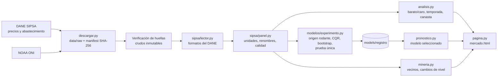

# NowMarket — precios mayoristas mensuales del SIPSA para Bogotá y la Sabana; no son precios al instante ni de tienda

[Ficha en el portafolio](https://johangb.github.io/proyectos/mercado-al-dia.html)

  

**¿Qué está barato este mes en la plaza, cuánto costará el próximo y qué conviene esperar?**
NowMarket responde con los precios mayoristas del **SIPSA** (Sistema de Información de Precios y
Abastecimiento del Sector Agropecuario, del DANE) para Bogotá y la Sabana, con Corabastos como referencia.

> **Estado: v1.1 (17-nov-2026).** Datos verificados, tablero útil sin aprendizaje automático, modelos
> validados con origen rodante y página. Una auditoría independiente encontró errores de método en la
> selección de modelos; se corrigieron y la prueba se repitió una vez (D-030). Con la regla corregida
> ningún modelo supera la valla: se usa el ingenuo calibrado en 1, 2 y 3 meses. No es asesoría financiera.
>
> El repositorio de GitHub es **NowMarket**; el paquete de Python se llama **`mercado_al_dia`** (los comandos, imports y
> rutas de este documento usan ese nombre y no cambian). El proyecto se llamó antes «Mercado al Día».

## Qué hace

| Pregunta | Cómo | Cómo se verificó |
|---|---|---|
| ¿Qué está barato este mes? | Precio del último mes frente a la mediana de sus 12 meses anteriores (±10 %) | Cada precio indica archivo, hoja y fila del Excel del DANE |
| ¿En qué meses suele estar caro? | Perfil de temporada por producto (media móvil 2×12 sobre el logaritmo) | El consejo "suele subir/bajar" acierta 78,2 % sin mirar el futuro, frente a 73,7 % de la línea base |
| ¿Cuánto costará en 1, 2 y 3 meses? | Ingenuo calibrado (el precio se mantiene, con rango del 80 %): ningún modelo lo superó con significancia en validación | Prueba 2023-11 a 2026-09: error típico 9,7 % a 1 mes; el rango cubrió 80,6–82,8 % |
| ¿Cómo ajusto la canasta a mi presupuesto? | Reemplaza productos por sustitutos más baratos, empezando por el que más ahorra | Sustitutos definidos por el autor; misma unidad de precio |
| ¿Qué debe vigilar un tendero? | Alzas y bajas del próximo mes | Reglas sobre el rango calibrado; con el ingenuo solo hay alerta si todo el rango queda de un lado del precio actual (hoy, ninguna) |
| ¿Qué productos se mueven juntos? | Correlación de los cambios mensuales sin la temporada | Solo se muestran pares con ρ ≥ 0,5 |

**Limitación principal.** El SIPSA mide el precio de venta **mayorista** en la central de abastos, con IVA,
en pesos de cada mes. En una tienda el precio es mayor (transporte, mermas, margen). Sirve para anticipar
subidas, bajadas y temporadas, no para saber cuánto pagará en la tienda.

**Qué significa «a 1 mes».** El precio de un mes se publica entre el día 6 y el 17 del mes siguiente. El
«pronóstico a 1 mes» se emite con ese mes siguiente ya iniciado, así que su horizonte real es de unas **2 a 3
semanas**, no un mes completo. Los precios son promedios mensuales: no son precios al instante.

## Resultados de los modelos

Protocolo fijado antes de ver la prueba (`config/modelos.yaml`):
- **Origen rodante sin fuga.** Cada mes se pronostica usando solo lo publicado hasta ese mes, incluida la
  lista de productos con que entrenan los modelos globales (corregido en v1.1).
- **Selección en validación.** Ventana 2021-11 a 2023-10.
- **Calibración conformal (CQR).** Los rangos se ajustan para cubrir el 80 %.
- **Regla de despliegue.** El modelo de menor pérdida en validación se usa solo si mejora a la mejor línea base
  con IC 90 % > 0, por bootstrap de bloques circulares de 3 meses consecutivos. Si no, se usa la línea base.
- **Prueba.** Ventana 2023-11 a 2026-09. **Ya se usó dos veces**: el 11-nov-2026 y, por la corrección de
  método (D-030), el 17-nov-2026. No puede volver a servir para decidir: cualquier decisión nueva sobre
  modelos necesita datos posteriores a 2026-09 (por ejemplo, validación 2023-11 a 2025-10 y prueba desde
  2025-11, cuando existan).

| Meses hacia adelante | Desplegado (v1.1) | Error típico | Rango cubrió | Antes (v1.0, con errores de método) |
|---|---|---|---|---|
| 1 | Ingenuo calibrado | 9,7 % | 80,6 % | LightGBM: 9,2 %, cubrió 83,3 % |
| 2 | Ingenuo calibrado | 16,0 % | 82,8 % | Ingenuo calibrado: 16,0 %, 83,0 % |
| 3 | Ingenuo calibrado | 20,2 % | 82,3 % | Ingenuo calibrado: 20,2 %, 82,6 % |

- **LightGBM:** fue el de menor pérdida en validación en los tres horizontes, pero su mejora a 1 mes (+4,2 %)
  tiene IC 90 % [−0,7 %; +8,6 %] con bloques de 3 meses: no pasa la valla. En la prueba sí le ganó al ingenuo;
  la regla se decide en validación y no se rescata mirando la prueba.
- **SARIMAX con ONI:** no mejoró al ingenuo con significancia.
- **N-BEATS (aprendizaje profundo, JAX):** perdió contra el ingenuo en todos los horizontes y no se despliega.
- Qué cambió y por qué: [`docs/auditoria_independiente.md`](docs/auditoria_independiente.md) y D-030 en
  [`docs/decisiones.md`](docs/decisiones.md). Antes y después lado a lado en [`docs/modelos.md`](docs/modelos.md).

Informe completo: [`docs/modelos.md`](docs/modelos.md). Fichas en [`models/model_cards/`](models/model_cards/).

## Alcance geográfico

| Lugar | ¿Hay dato SIPSA? | Qué se hace |
|---|---|---|
| Bogotá, Corabastos | Sí, 2013–2026, unos 175 productos | **Referencia para Bogotá y la Sabana** |
| Bogotá, Paloquemao | Sí, 2013–2026, 79–104 productos | Línea de comparación en cada producto |
| Madrid (Cundinamarca) y la Sabana | No hay mercado SIPSA | Se usa Corabastos, rotulado como referencia (decisión del autor) |

## Uso

Requisitos: Python 3.10 o superior. Funciona en Windows 11 con 8 GB de RAM y sin GPU.

```
python -m venv .venv
.venv\Scripts\activate                     (Windows)  |  source .venv/bin/activate  (macOS/Linux)
pip install -e .[dev]
python -m mercado_al_dia.ingesta.descargar # baja los datos públicos y los registra con SHA-256
python -m mercado_al_dia                   # tablero, minería y pronóstico (unos 40 s)
python -m pytest -q                        # 72 pruebas sin internet (71 pasan y 1 es un fallo esperado documentado); pip install -e .[dev,dl] para no omitir N-BEATS
```

**`data/raw/` y `data/procesado/` no vienen en el repositorio** (no se versionan: licencia del DANE y tamaño;
D-006 y D-017). Se crean al ejecutar: `python -m mercado_al_dia.ingesta.descargar` baja los crudos a
`data/raw/` y `python -m mercado_al_dia` genera `data/procesado/` (incluido `precios_bogota.csv`). Sin esos
dos pasos no existe ni el tablero ni el panel que usan los modelos.

Abra `data/procesado/mercado.html`. Para repetir el experimento de modelos:
`python -m mercado_al_dia.modelos.experimento validacion` y luego `... prueba` (se niega a repetirla).
La ventana de prueba actual ya está gastada (D-030): ver arriba.
N-BEATS necesita `pip install -e .[dl]`.

Tablas generadas en `data/procesado/`:
- `precios_bogota.csv`: cada precio con su origen.
- `indicadores_corabastos.csv`
- `pronosticos.csv`
- `alertas_tenderos.csv`
- `vecinos.csv`
- `cambios_de_nivel.csv`
- `grupos_movimiento.csv`
- `canasta.csv`
- `validacion_estacional.csv`
- `calidad.json`: duplicados, renombres, saltos extremos (meses consecutivos y con hueco), datos sospechosos
  (solo se reportan, no se borran) y resumen.

## Flujo



## Estructura

```
config/            fuentes, productos (unidades y renombres), canasta, sustitutos, análisis, modelos
data/raw/          crudos inmutables (no se versionan)      data/manifest.json   huellas SHA-256
data/procesado/    tablas y página (se regeneran)
docs/              fase0_datos, modelos, supuestos, decisiones, uso_de_ia
models/registro/   selección, prueba y pronósticos de cada origen (v1.1)
models/registro_antes/  registro de la v1.0, intacto (antes de las correcciones)
models/model_cards/
src/mercado_al_dia/  ingesta · sipsa (lector, panel) · analisis · modelos · mineria · pronostico · pagina · proceso
tests/             72 pruebas: lector, panel, temporada, sin fuga, CQR, bootstrap, prueba única, minería y auditoría
```

## Fuentes y licencia de datos

Departamento Administrativo Nacional de Estadística (DANE), SIPSA: series históricas mensuales de precios
mayoristas y de abastecimiento. NOAA Climate Prediction Center: índice ONI. Los datos crudos no se
redistribuyen; se descargan con el script.

Proyecto personal de portafolio de Johan García. El DANE no participa ni lo respalda.
